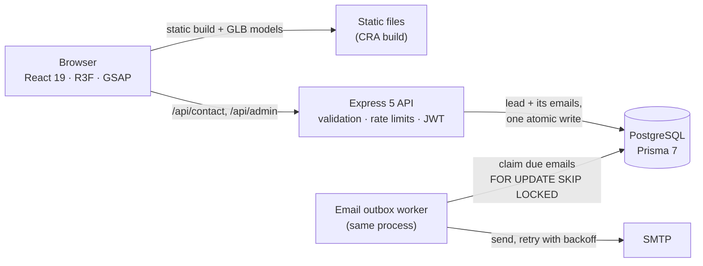

# Porsche 3D Showroom

A scroll-driven 3D car showroom built with React Three Fiber and GSAP, with a lead-capture backend
(Express, Prisma, PostgreSQL) and an admin dashboard. Five cars have hand-choreographed 3D pages;
six more have photo-based model pages.

> Independent, non-commercial portfolio project. Not affiliated with, endorsed by or sponsored by
> Porsche AG. 3D models are credited below; photographs are used for demonstration purposes only.

| 911 GT3 RS | Taycan Turbo GT |
|---|---|
|  |  |
| **Cayenne Turbo GT** | **911 Turbo S** |
|  |  |
| **918 Spyder** | |
|  | |

*These are the pipeline's own stage screenshots (first scroll stage of each showroom), so they
show exactly what the current code renders.*

## What it does

- **3D showrooms (5 cars).** Each page scrolls through 8–9 sections (powertrain, brakes,
  cockpit, specs, ...); GSAP ScrollTrigger moves the camera and car between hand-tuned poses.
  The GT3 RS and Cayenne add post-processing (bloom, chromatic aberration, vignette).
- **Model pages (11 cars)** with carousels and spec sections, an "All models" overview, and
  About / Services / Experience pages.
- **Contact form → lead pipeline.** Server-side validation (Latin-script names, real phone
  numbers, known models), rate limiting, and emails delivered through a **transactional outbox**
  with retries.
- **Admin dashboard.** JWT login with rate limiting and expiry, server-side search and paging,
  a status pipeline (new → contacted → qualified → closed), analytics, CSV export, and each lead's
  email delivery status.

## Measured performance

Production build, every byte counted by Chrome (`scripts/measure-page-weight.cjs`). Full history in
[`docs/perf-baseline.md`](porsche-react-master/docs/perf-baseline.md).

| | Before | Now |
|---|---|---|
| `/` (home) | 135.9 MB | **5.2 MB** |
| `/contact` | 131.7 MB | **0.9 MB** |
| `/models/911-gt3-rs` (heaviest showroom) | 133.2 MB | **69.7 MB** (its own 65.9 MB model) |
| 3D models downloaded on a non-3D page | 5 of 5 | **0** |
| `main.js`, gzipped | 670 kB | **197 kB** |

All five models were preloaded at module import, so every page, even `/contact`, downloaded
~130 MB. The showrooms are now lazy route chunks, and the admin charts no longer ship to every
visitor. Every route has a byte budget that the verification pipeline enforces (below).

## Architecture



## Engineering decisions

- **The 3D choreography is treated as protected data.** The camera poses are hand-tuned; changing
  one coordinate breaks a scene. A guard hashes every choreography block, canvas and layout input
  (33 items), and the pipeline compares 44 GPU screenshots of every scroll stage against a
  baseline. Proven: a one-digit camera change in a scratch copy failed only the guard.
- **Emails go through a transactional outbox.** A lead and one row per email are written
  atomically. A worker claims rows with `FOR UPDATE SKIP LOCKED` plus a lease, sends outside the
  transaction, and retries each email on its own (exponential backoff, 5 attempts). A crash never
  loses an email, and a retry never re-sends one that already went out (at-least-once delivery).
  Cost measured: about +2.5 ms p50 per submit.
- **Texture compression was evaluated, not shipped.** A texture-only WebP pass took the GT3 RS
  model from 65.9 to 46.6 MB, with geometry proven byte-identical and every stage screenshot
  matching, but the original was kept by choice. Geometry compression (Draco/Meshopt) was ruled
  out because it moves vertices and the framing depends on them.
- **Performance is a tested property.** Every route has a ceiling (measured size + 10%, about 7x
  the measurement noise) and `main.js` has its own gzip limit. A worktree proof showed each catches
  a regression the other misses.
- **Honest UI.** Fake features found in the audit (a signup that said "subscribed" while sending
  nothing, settings toggles that did nothing, a real-time endpoint no browser could authenticate to) were removed
  or made truthful.

## Verification

One command per depth, run locally (no hosted CI by choice). Both need Docker for the throwaway
test database.

```bash
npm run verify        # ~1 min: trajectory guard, backend tests, frontend tests, dependency audit, E2E
npm run verify:full   # ~9 min: + fresh build with bundle checks, page-weight budgets for 25 routes,
                      #   44 3D stage screenshots, SIGTERM shutdown inside a Linux container
```

| Gate | What it proves |
|---|---|
| Trajectory guard | No choreography, canvas or layout input changed (33 hashed items) |
| Backend tests (122) | API, validation, auth, CSV safety, email outbox (incl. concurrency), migrations on a real Postgres |
| Frontend tests (89) | Routing, forms, auth flow, dashboard, error boundaries, credits |
| E2E (7, Puppeteer) | Contact form → admin login → search → status change → logout, against the real backend |
| Bundle + page weight | No admin/3D library in `main.js`; every route within its byte budget and model count |
| Stage screenshots (44) | Every scroll stage of every showroom matches the baseline (GPU) |
| SIGTERM | The API finishes in-flight requests and exits cleanly in a Linux container |

## Getting started

**Prerequisites:** Node.js `^20.19 || ^22.12 || >=24`, PostgreSQL, a WebGL-capable GPU for the 3D
pages, and Docker if you want to run the tests.

```bash
git clone https://github.com/Priyanshh1407/porsche-react.git
cd porsche-react

# Backend
cd porsche-backend
cp .env.example .env            # fill in DATABASE_URL, JWT_SECRET (32+ chars), ADMIN_EMAIL, ADMIN_PASSWORD
npm install                     # also generates the Prisma client
npx prisma migrate deploy       # creates the tables
npm start                       # http://localhost:5000  (GET /ready checks the database)

# Frontend (second terminal)
cd porsche-react-master
npm install
npm start                       # http://localhost:3000, proxies /api to :5000
```

Leave `EMAIL_PASS` empty and emails are logged to the console instead of sent. Upgrading an older
database created with `prisma db push`? Follow
[`porsche-backend/prisma/MIGRATIONS.md`](porsche-backend/prisma/MIGRATIONS.md). Hosting notes:
[`DEPLOY.md`](DEPLOY.md).

## Known limitations

- **Single admin**, configured by environment variables, with a plaintext password compared in
  constant time (a deliberate choice for a one-person demo; rate-limited and fail-closed).
- **Not deployed.** The project lives in this repository; `DEPLOY.md` describes how it could be
  hosted. Free hosting tiers would add cold starts.
- **Heavy pages.** The GT3 RS showroom downloads ~70 MB. Some photo-based pages are 8–13 MB
  because of single oversized photos (e.g. a 9.7 MB image on `/models/macan-gts`).
- **3D pages need a WebGL-capable GPU.** Without WebGL a fallback message is shown instead of the
  scene.
- **Stage-screenshot baselines are GPU-specific.** A different machine needs its own baseline.
- **Not everything is wired up:** the footer's newsletter box does nothing, there are no legal
  pages, and the Configurator says it is coming soon.
- **Create React App is deprecated**; a move to Vite would be the next infrastructure step.

## Tech stack

**Frontend:** React 19, React Router 7, Three.js, React Three Fiber, Drei, React Postprocessing,
GSAP ScrollTrigger, Tailwind CSS, Recharts. **Backend:** Node.js, Express 5, Prisma 7 with the `pg`
adapter, PostgreSQL, express-validator, express-rate-limit, helmet, nodemailer, morgan.
**Testing:** Jest, React Testing Library, Supertest, Puppeteer, Docker.

## Credits and licences

3D models (author, licence and source as embedded in each file); also shown on the site's
`/credits` page:

| Model | Author | Licence |
|---|---|---|
| [2024 Manthey Racing Porsche 911 GT3 RS](https://sketchfab.com/3d-models/2024-manthey-racing-porsche-911-gt3-rs-09ccead93fb34944bde812d4b4684eff) | [HYPR:IMPS 3D](https://sketchfab.com/HYPRIMPS3D) | [CC BY 4.0](https://creativecommons.org/licenses/by/4.0/) |
| [2025 Porsche Taycan Turbo GT Weissach Package](https://sketchfab.com/3d-models/2025-porsche-taycan-turbo-gt-weissach-package-4e1abafe7cf5413587a421377624ba08) | [Ddiaz Design](https://sketchfab.com/ddiaz-design) | [CC BY-NC-SA 4.0](https://creativecommons.org/licenses/by-nc-sa/4.0/) |
| [2022 Porsche Cayenne Turbo GT](https://sketchfab.com/3d-models/2022-porsche-cayenne-turbo-gt-74fbea5a4dfc4197839fdd2bf654369a) | [Ddiaz Design](https://sketchfab.com/ddiaz-design) | [CC BY 4.0](https://creativecommons.org/licenses/by/4.0/) |
| [Porsche 911 Turbo S](https://sketchfab.com/3d-models/porsche-911-turbo-s-081cf9a708bb4b8b8f14d55b56ffdfe9) | [3D Cars Studio](https://sketchfab.com/3DC_STUDIO) | [CC BY-NC-SA 4.0](https://creativecommons.org/licenses/by-nc-sa/4.0/) |
| [2014 - Porsche 918 Spyder (Rigged) Mid-Poly](https://sketchfab.com/3d-models/2014-porsche-918-spyder-rigged-mid-poly-1d34d42ce58c48f49146346ff67e492d) | [UniBlend](https://sketchfab.com/UniBlend) | [CC BY 4.0](https://creativecommons.org/licenses/by/4.0/) |

The two CC BY-NC-SA models may not be used commercially, and adaptations of them must be shared
under the same licence.

**Photographs** were collected from various sources and are used for demonstration purposes only.
All rights remain with their respective owners; none are used commercially.

Porsche, the Porsche crest and the model names are trademarks of Dr. Ing. h.c. F. Porsche AG.
