# Porsche 3D Showroom

A scroll-driven 3D car showroom built with React Three Fiber and GSAP, with a lead-capture backend
(Express, Prisma, PostgreSQL) and an admin dashboard. Five cars have hand-choreographed 3D pages;
six more have photo-based model pages.

> Independent, non-commercial portfolio project. Not affiliated with, endorsed by or sponsored by
> Porsche AG. 3D models are credited below; photographs are used for demonstration purposes only.

| 911 GT3 RS | Taycan Turbo GT |
|---|---|
| 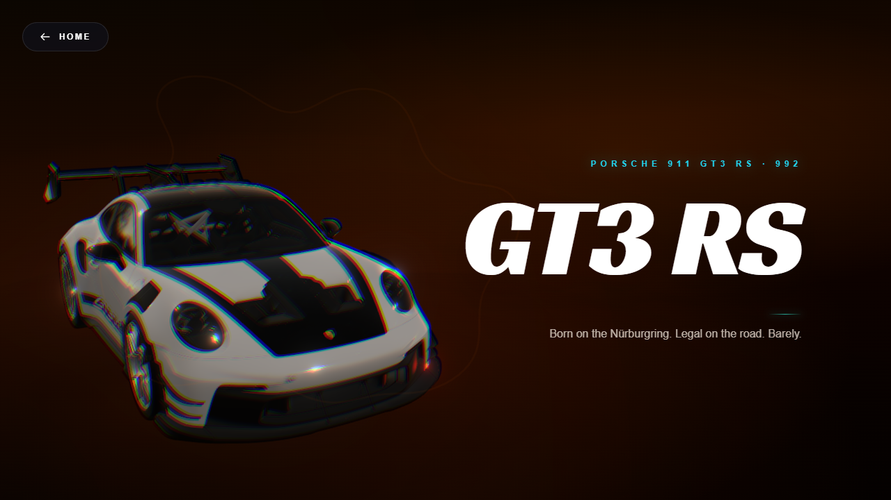 | 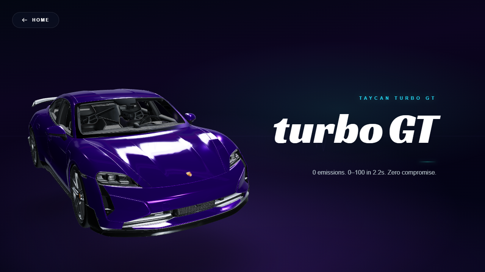 |
| **Cayenne Turbo GT** | **911 Turbo S** |
| 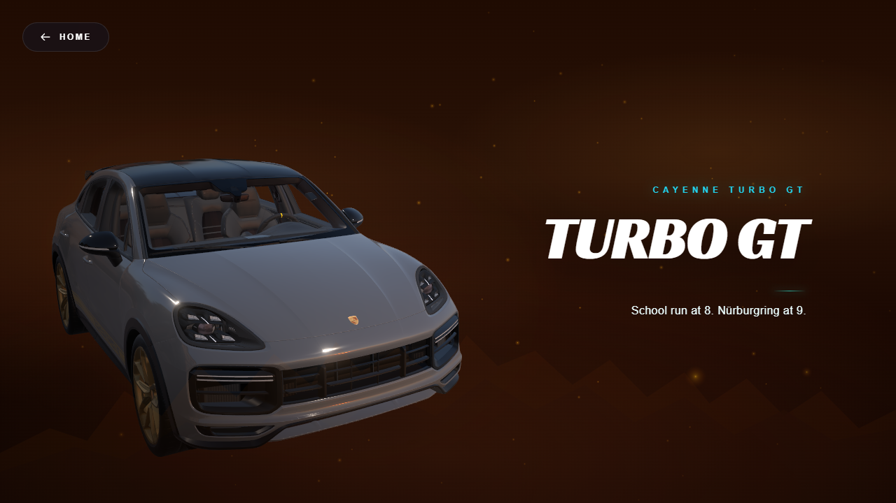 | 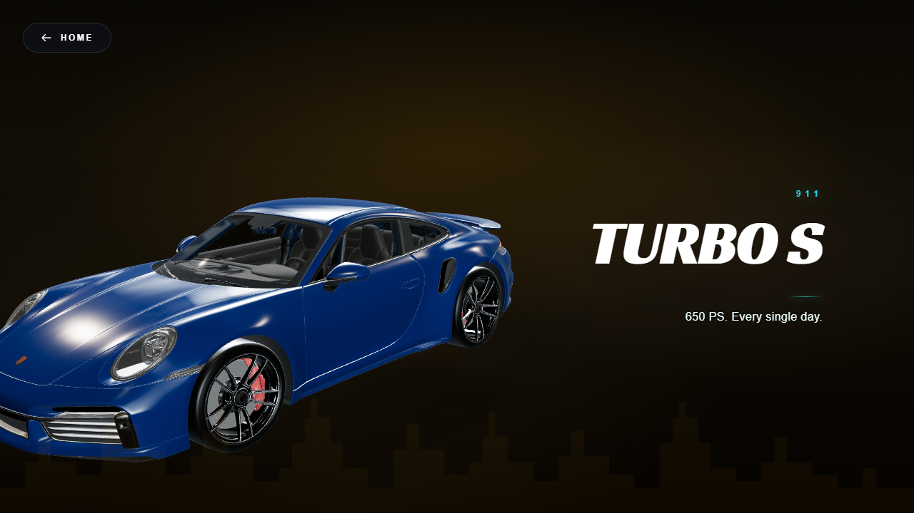 |
| **918 Spyder** | |
| 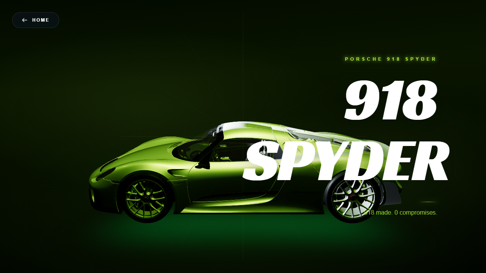 | |

**Each car has its own signature moment**, a scroll section with an effect built for that car:

| 911 GT3 RS: the rear wing opens (DRS) | 911 GT3 RS: brake discs glow after a lap |
|---|---|
| 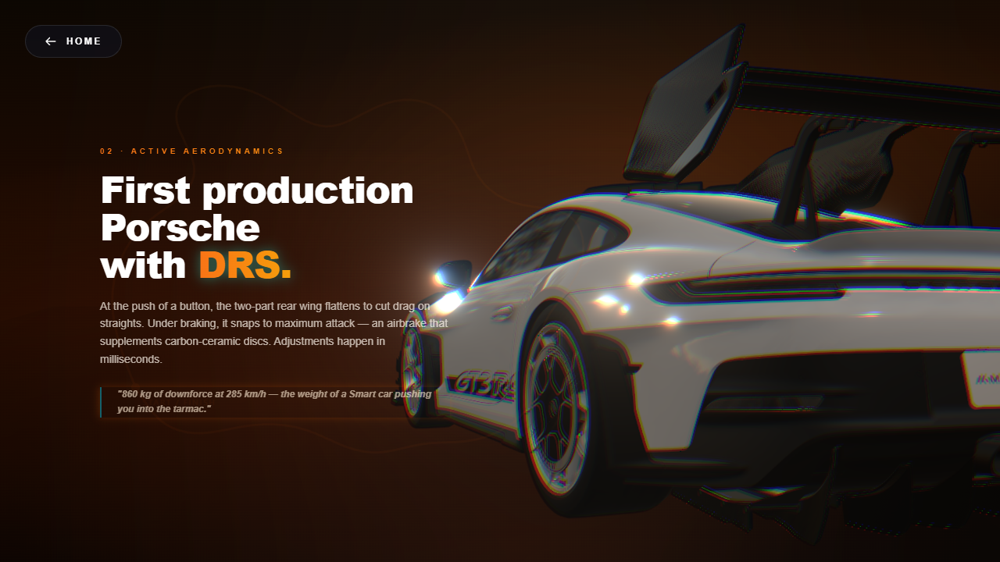 | 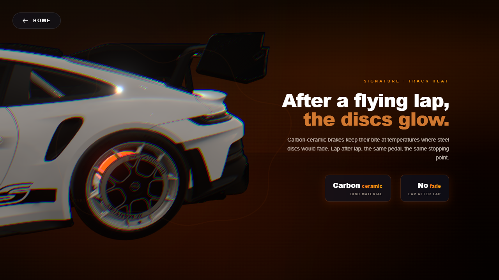 |
| **Taycan: an 800-volt energy pulse** | **Cayenne: dust rising off the trail** |
| 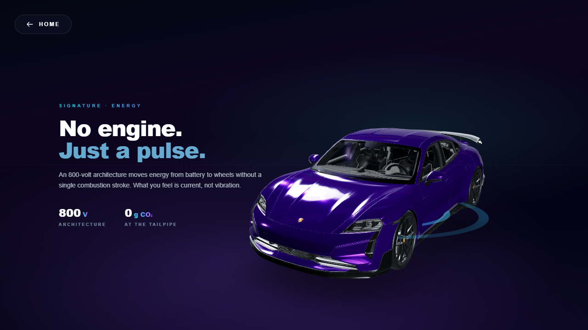 |  |
| **911 Turbo S: night falls, headlights on** | **918 Spyder: E-Power, Hybrid and Race modes** |
| 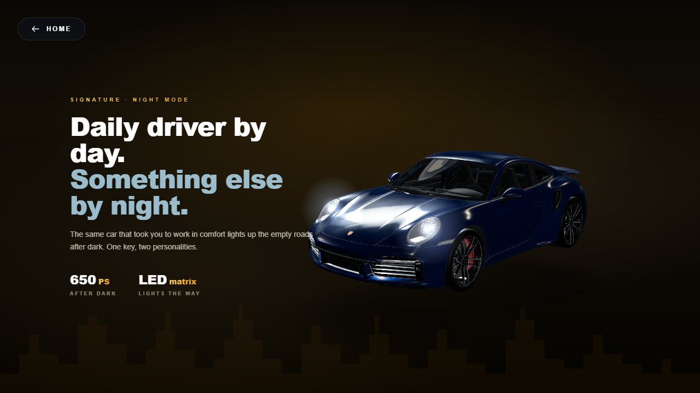 | 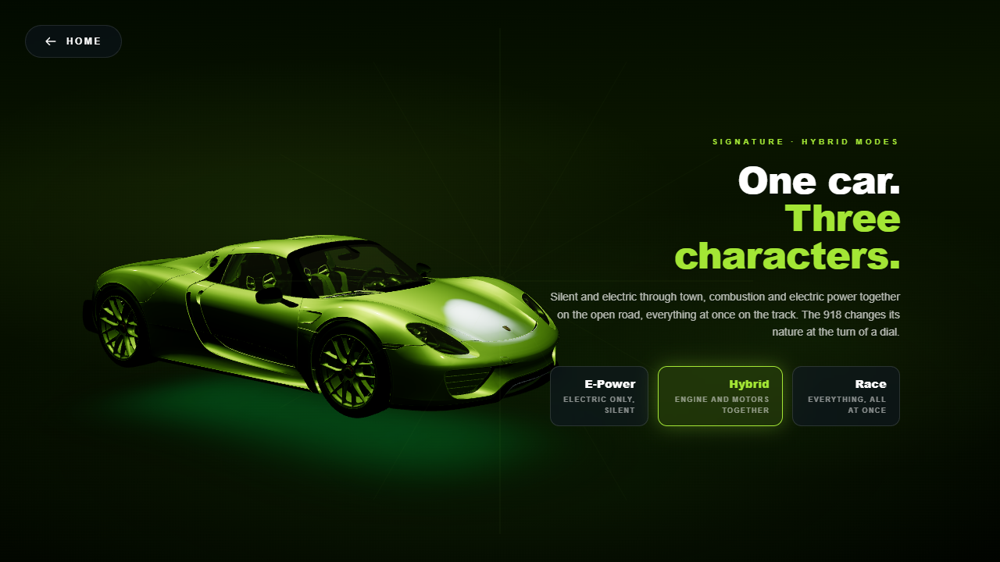 |

*All of these are the verification pipeline's own stage screenshots, so they show exactly what the
current code renders.*

### Demo

Scrolling the GT3 RS showroom: each section triggers a hand-tuned camera move.


A lead from the contact form reaches the admin dashboard, with its email delivery status.


*Both recorded from the local production build (the lead flow against the real API and a test
database, emails in demo mode).*

## What it does

- **3D showrooms (5 cars).** Each page scrolls through 9–10 sections (powertrain, brakes,
  cockpit, specs, ...); GSAP ScrollTrigger moves the camera and car between hand-tuned poses.
  The GT3 RS and Cayenne add post-processing (bloom, chromatic aberration, vignette).
- **A signature section per car,** each a self-contained effect that restores everything it touches:
  the GT3 RS's DRS wing tilts open (its blade turned about its own centre) and its brake discs
  glow, the Taycan pulses with energy rings, the Cayenne kicks up dust, the 911 Turbo S switches
  to night with its headlights on, and the 918 Spyder cycles through its three hybrid modes.
  Every looping effect has a still frame for `prefers-reduced-motion`.
- **Model pages (11 cars)** with carousels and spec sections, each with its own feature (the
  718 Boxster's is an animated open-top sequence), an "All models" overview, and About / Services /
  Experience pages.
- **Contact form → lead pipeline.** Server-side validation (Latin-script names, real phone
  numbers, known models), rate limiting, and emails delivered through a **transactional outbox**
  with retries.
- **Admin dashboard.** JWT login with rate limiting and expiry, server-side search and paging,
  a status pipeline (new → contacted → qualified → closed), analytics (30-day trend, all-time
  model popularity and funnel), CSV export, and each lead's email delivery status.

## Measured performance

Production build, every byte counted by Chrome (`scripts/measure-page-weight.cjs`). Full history in
[`docs/perf-baseline.md`](porsche-react-master/docs/perf-baseline.md).

| | Before | Now |
|---|---|---|
| `/` (home) | 135.9 MB | **5.2 MB** |
| `/contact` | 131.7 MB | **0.9 MB** |
| `/models/911-gt3-rs` (heaviest showroom) | 133.2 MB | **69.7 MB** (its own 65.9 MB model) |
| 3D models downloaded on a non-3D page | 5 of 5 | **0** |
| `main.js`, gzipped | 670 kB | **195 kB** |

All five models were preloaded at module import, so every page, even `/contact`, downloaded
~130 MB. The showrooms are now lazy route chunks, and the admin charts no longer ship to every
visitor. Every route has a byte budget that the verification pipeline enforces (below).

## Architecture

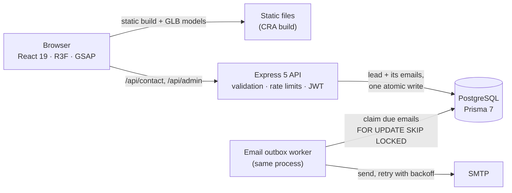

## Engineering decisions

- **The 3D choreography is treated as protected data.** The camera poses are hand-tuned; changing
  one coordinate breaks a scene. A guard hashes every choreography block, canvas and layout input
  (33 items), and the pipeline compares 49 GPU screenshots of every scroll stage against a
  baseline. Proven: a one-digit camera change in a scratch copy failed only the guard.
- **Emails go through a transactional outbox.** A lead and one row per email are written
  atomically. A worker claims rows with `FOR UPDATE SKIP LOCKED` plus a lease, sends outside the
  transaction, and retries each email on its own (exponential backoff, 5 attempts). A crash never
  loses an email, and a retry never re-sends one that already went out (at-least-once delivery).
  Cost measured: about +2.5 ms p50 per submit.
- **Every change is audited in the same transaction.** Status and notes changes, deletions, CSV
  exports and admin logins each write an audit event (who, what, before/after) inside the
  transaction that makes the change, so the log can't disagree with the data. Each lead has a
  timeline; the full log pages with a keyset cursor.
- **AI lead triage as a durable job.** Each lead is scored hot / warm / cold by Google Gemini with a
  one-line summary and next step, through structured JSON output that is validated again before it
  is stored. The job is queued in the lead's own transaction and worked off like the email outbox
  (lease, `SKIP LOCKED`, retries), so it survives crashes, and it waits harmlessly until an API key
  is configured. The model never sees the visitor's contact details.
- **A 3D configurator that can't break the showrooms.** Pick one of four cars, eight paints and
  three finishes (gloss / satin / matte through roughness and clear coat), orbit the car, share the
  build by URL, and send it to the contact form pre-filled. The showrooms render the same cached
  models, so the configurator repaints a clone with its own copies of only the paint materials
  (unit-tested: the original scene is untouched). Paint materials were found by scanning the GLBs;
  the GT3 RS is left out because its paint is a livery texture.
- **An AI concierge that can't make things up or skip the rules.** The chat answers through
  Gemini function calling over a catalogue **generated from the site's own model data** (a test
  fails if they drift), and books test drives through the same lead pipeline and validation as the
  contact form, only after the visitor confirms. Hard limits on turns, tool calls, input size and
  rate. The real SDK path is tested end to end against a local fake Gemini, so no key is needed.
- **Live admin dashboard without polling.** New leads and changes reach every open dashboard
  over Server-Sent Events. The event is a Postgres `NOTIFY` sent inside the change's transaction,
  so it arrives only after commit and works across several API instances; the browser authenticates
  with a single-use 30-second ticket instead of putting the JWT in a URL.
- **Texture compression was evaluated, not shipped.** A texture-only WebP pass took the GT3 RS
  model from 65.9 to 46.6 MB, with geometry proven byte-identical and every stage screenshot
  matching, but the original was kept by choice. Geometry compression (Draco/Meshopt) was ruled
  out because it moves vertices and the framing depends on them.
- **Performance is a tested property.** Every route has a ceiling (measured size + 10%, about 7x
  the measurement noise) and `main.js` has its own gzip limit. A worktree proof showed each catches
  a regression the other misses.
- **Honest UI.** Fake features found in the audit (a signup that said "subscribed" while sending
  nothing, settings toggles that did nothing, a real-time endpoint no browser could authenticate to) were removed
  or made truthful.

## Verification

One command per depth, run locally (no hosted CI by choice). **No Docker needed:** the throwaway
test database is a real PostgreSQL started for the run (embedded, via `embedded-postgres`) and
removed afterwards. If Docker happens to be running, the pipeline uses its test-db container instead.

```bash
npm run verify        # ~1 min: trajectory guard, backend tests, frontend tests, dependency audit, E2E
npm run verify:full   # ~20 min: + fresh build with bundle checks, page-weight budgets for 25 routes,
                      #   49 3D stage screenshots, SIGTERM shutdown check
```

| Gate | What it proves |
|---|---|
| Trajectory guard | No choreography, canvas or layout input changed (33 hashed items) |
| Backend tests (189) | API, validation, auth, CSV safety, email outbox (incl. concurrency), audit log (same-transaction rollback, keyset paging), live events (commit-only delivery, single-use tickets), AI triage and concierge with a fake model (schema validation, retries, no double triage, tool loop, booking rules, limits), the real Gemini SDK against a fake REST server, catalogue and migration drift, UTF-8 database, migrations and UTC sessions on a real Postgres |
| Frontend tests (175) | Routing, forms, auth flow, dashboard, charts, lead timeline, live updates (reconnect with a fresh ticket), AI triage badges, concierge widget, configurator (clone repaint, URL, contact pre-fill), error boundaries, credits, 3D signature effects |
| E2E (10, Puppeteer) | Contact form → admin login → search → status change → logout, a live new-lead toast, a phone-width concierge chat that books a test drive which the AI then triages, and configurator → pre-filled contact form, against the real backend and a local fake Gemini |
| Bundle + page weight | No admin/3D library in `main.js`; every route within its byte budget (first-party bytes) and model count |
| Stage screenshots (49) | Every scroll stage of every showroom matches the baseline (GPU) |
| SIGTERM | The API finishes in-flight requests, ends open live-event streams and exits cleanly on a real SIGTERM (in a Linux container with Docker, natively on Linux/macOS; skipped on Windows without Docker, which has no real SIGTERM) |

## Getting started

**Prerequisites:** Node.js `^20.19 || ^22.12 || >=24`, PostgreSQL, a WebGL-capable GPU for the 3D
pages. Docker is optional (tests start their own PostgreSQL).

```bash
git clone https://github.com/Priyanshh1407/porsche-react.git
cd porsche-react

# Backend
cd porsche-backend
cp .env.example .env            # fill in DATABASE_URL, JWT_SECRET, ADMIN_EMAIL, ADMIN_PASSWORD
npm install                     # also generates the Prisma client
npx prisma migrate deploy       # creates the tables
npm start                       # http://localhost:5000  (GET /ready checks the database)

# Frontend (second terminal)
cd porsche-react-master
npm install
npm start                       # http://localhost:3000, proxies /api to :5000
```

To judge smoothness, try the production build: the dev server runs React in development mode
(StrictMode, unminified three.js) and is noticeably less smooth.

```bash
npm run build && npm run preview   # http://localhost:3000, /api forwarded to :5000 like a real host
```

Leave `EMAIL_PASS` empty and emails are logged to the console instead of sent. The AI features
(lead triage, concierge chat) are off until you set `GEMINI_API_KEY` in `porsche-backend/.env` and
restart the backend; nothing else is needed. `npm start` in the frontend prints
"Failed to parse source map … @mediapipe/tasks-vision": that's harmless (a dependency of Drei ships
without its source map). Tested from a fresh clone: about 5 minutes to a working site. Upgrading an older
database created with `prisma db push`? Follow
[`porsche-backend/prisma/MIGRATIONS.md`](porsche-backend/prisma/MIGRATIONS.md). Hosting notes:
[`DEPLOY.md`](DEPLOY.md).

## Known limitations

- **Single admin**, configured by environment variables, with a plaintext password compared in
  constant time (a deliberate choice for a one-person demo; rate-limited and fail-closed).
- **Not deployed.** The project lives in this repository; `DEPLOY.md` describes how it could be
  hosted. Free hosting tiers would add cold starts.
- **Heavy pages.** The GT3 RS showroom downloads ~70 MB. Some photo-based pages are 8–13 MB
  because of single oversized photos (e.g. a 9.7 MB image on `/models/macan-gts`).
- **3D pages need a WebGL-capable GPU.** Without WebGL a fallback message is shown instead of the
  scene.
- **Stage-screenshot baselines are GPU-specific.** A different machine needs its own baseline.
- **Not everything is wired up:** the footer's newsletter box does nothing, there are no legal
  pages, and the Configurator says it is coming soon.
- **Third-party runtime dependencies.** Four showrooms load their lighting (Drei `Environment`
  presets, 1.3–1.7 MB) from `raw.githack.com`; if that service is unavailable, those scenes can't
  light the car. Self-hosting the HDR files would remove the dependency. The Services page shows
  random placeholder photos from `picsum.photos`, so its images change on every visit.
- **Create React App is deprecated**; a move to Vite would be the next infrastructure step.

## Tech stack

**Frontend:** React 19, React Router 7, Three.js, React Three Fiber, Drei, React Postprocessing,
GSAP ScrollTrigger, Tailwind CSS, Recharts. **Backend:** Node.js, Express 5, Prisma 7 with the `pg`
adapter, PostgreSQL, express-validator, express-rate-limit, helmet, nodemailer, morgan.
**Testing:** Jest, React Testing Library, Supertest, Puppeteer, embedded PostgreSQL (Docker optional).

## Credits and licences

3D models (author, licence and source as embedded in each file); also shown on the site's
`/credits` page:

| Model | Author | Licence |
|---|---|---|
| [2024 Manthey Racing Porsche 911 GT3 RS](https://sketchfab.com/3d-models/2024-manthey-racing-porsche-911-gt3-rs-09ccead93fb34944bde812d4b4684eff) | [HYPR:IMPS 3D](https://sketchfab.com/HYPRIMPS3D) | [CC BY 4.0](https://creativecommons.org/licenses/by/4.0/) |
| [2025 Porsche Taycan Turbo GT Weissach Package](https://sketchfab.com/3d-models/2025-porsche-taycan-turbo-gt-weissach-package-4e1abafe7cf5413587a421377624ba08) | [Ddiaz Design](https://sketchfab.com/ddiaz-design) | [CC BY-NC-SA 4.0](https://creativecommons.org/licenses/by-nc-sa/4.0/) |
| [2022 Porsche Cayenne Turbo GT](https://sketchfab.com/3d-models/2022-porsche-cayenne-turbo-gt-74fbea5a4dfc4197839fdd2bf654369a) | [Ddiaz Design](https://sketchfab.com/ddiaz-design) | [CC BY 4.0](https://creativecommons.org/licenses/by/4.0/) |
| [Porsche 911 Turbo S](https://sketchfab.com/3d-models/porsche-911-turbo-s-081cf9a708bb4b8b8f14d55b56ffdfe9) | [3D Cars Studio](https://sketchfab.com/3DC_STUDIO) | [CC BY-NC-SA 4.0](https://creativecommons.org/licenses/by-nc-sa/4.0/) |
| [2014 - Porsche 918 Spyder (Rigged) Mid-Poly](https://sketchfab.com/3d-models/2014-porsche-918-spyder-rigged-mid-poly-1d34d42ce58c48f49146346ff67e492d) | [UniBlend](https://sketchfab.com/UniBlend) | [CC BY 4.0](https://creativecommons.org/licenses/by/4.0/) |

The two CC BY-NC-SA models may not be used commercially, and adaptations of them must be shared
under the same licence.

**Photographs** were collected from various sources and are used for demonstration purposes only.
All rights remain with their respective owners; none are used commercially.

Porsche, the Porsche crest and the model names are trademarks of Dr. Ing. h.c. F. Porsche AG.
